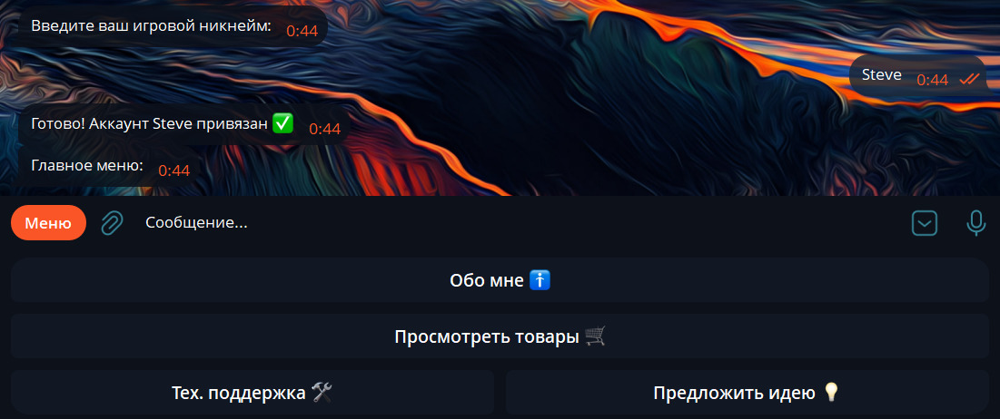
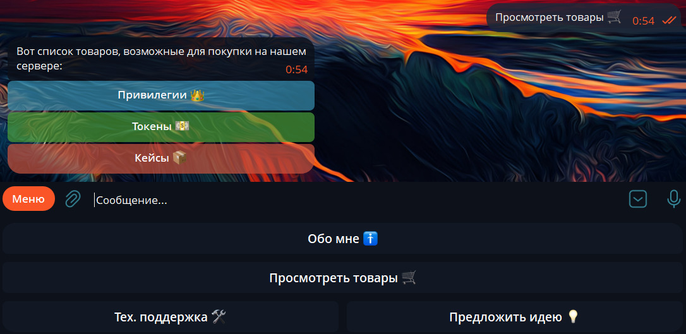
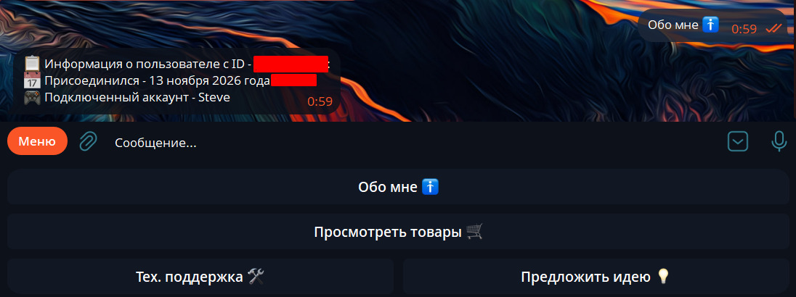

# 🎮 Minecraft Telegram Bot & CRM Integration

[](https://www.python.org/)
[](https://docs.aiogram.dev/)
[](https://www.sqlite.org/)

Готовое решение для владельцев Minecraft-серверов: Telegram-бот с элементами CRM, магазином и прямой интеграцией с игровым сервером.

👉 **Попробовать демо-бота:** [@OurVillageShopBot](https://t.me/OurVillageShopBot) *(работает в демо-режиме без реального игрового сервера)*

---

## 💡 Ценность для игрового бизнеса

Владельцы серверов часто тратят время на ручную выдачу привилегий, проверку баланса и обработку заявок. Этот бот автоматизирует рутину:

- **Продажи на автопилоте:** Игрок покупает товар в Telegram, бот моментально выдает его в игре.
- **Снижение нагрузки на админов:** Проверка статуса аккаунта и баланса доступна игрокам 24/7.
- **Безопасность:** Встроенная защита от брутфорса (подбора паролей) и изоляция секретных данных.
- **Удобство:** Игроку не нужно заходить на сайт или писать в поддержку — всё в привычном Telegram.

## ✨ Основные возможности

- **Интеграция с AuthMe:** Проверка регистрации игрока и валидация пароля (SHA-256 + соль).
- **RCON-подключение:** Безопасная выдача предметов и привилегий напрямую на сервер.
- **CRM-система (SQLite):** Хранение привязанных аккаунтов, истории покупок и защита от спама.
- **Админ-панель:** Управление балансом пользователей, рассылки и просмотр статистики.
- **Демо-режим:** Возможность протестировать весь функционал без необходимости поднимать реальный Minecraft-сервер.

---

## 🏗 Архитектура и стек

Проект спроектирован по модульному принципу: логика бота отделена от работы с базами данных и игровым сервером.

```text
[ Telegram User ]
       │
       ▼
[ Aiogram 3 (Handlers) ] ──► [ SQLite (Users, Links, Blocked) ]
       │
       ├──► [ AuthMe DB (Проверка паролей) ]
       │
       └──► [ RCON Client ] ──► [ Minecraft Server ]
```

**Стек:** Python 3, Aiogram 3, SQLite (aiosqlite/sqlite3), RCON, python-dotenv.  
**Деплой:** Railway (конфигурация через переменные окружения).

## 🚀 Быстрый старт (для разработчиков)

Хотите запустить проект локально? Это займет 2 минуты.

### Клонируйте репозиторий

```bash
git clone https://github.com/Emil201234/minecraft-telegram-bot-crm-integration.git
cd minecraft-telegram-bot-crm-integration
```

### Установите зависимости

```bash
pip install -r requirements.txt
```

### Настройте окружение

Скопируйте шаблон и заполните его своими данными:

```bash
cp .env.example .env
```

В файле `.env` укажите `BOT_TOKEN` от @BotFather. Для быстрого теста оставьте `DEMO_MODE=True`.

### Запустите бота

```bash
python main.py
```

## 🔒 Безопасность

Проект следует современным практикам безопасной разработки:

- **Никаких секретов в коде:** Все токены и пароли хранятся в `.env` (который добавлен в `.gitignore`).
- **Защита от SQL-инъекций:** Все запросы к базе данных параметризованы.
- **Anti-bruteforce:** Ограничение попыток ввода пароля с временной блокировкой в БД.
- **Безопасная работа с RCON:** Отключение опасных команд на уровне кода.

## 🖼 Скриншоты

<p align="left">
  
  
  
</p>

Разработано как pet-проект и портфолио для демонстрации навыков разработки Telegram-ботов и интеграции с игровыми серверами.
